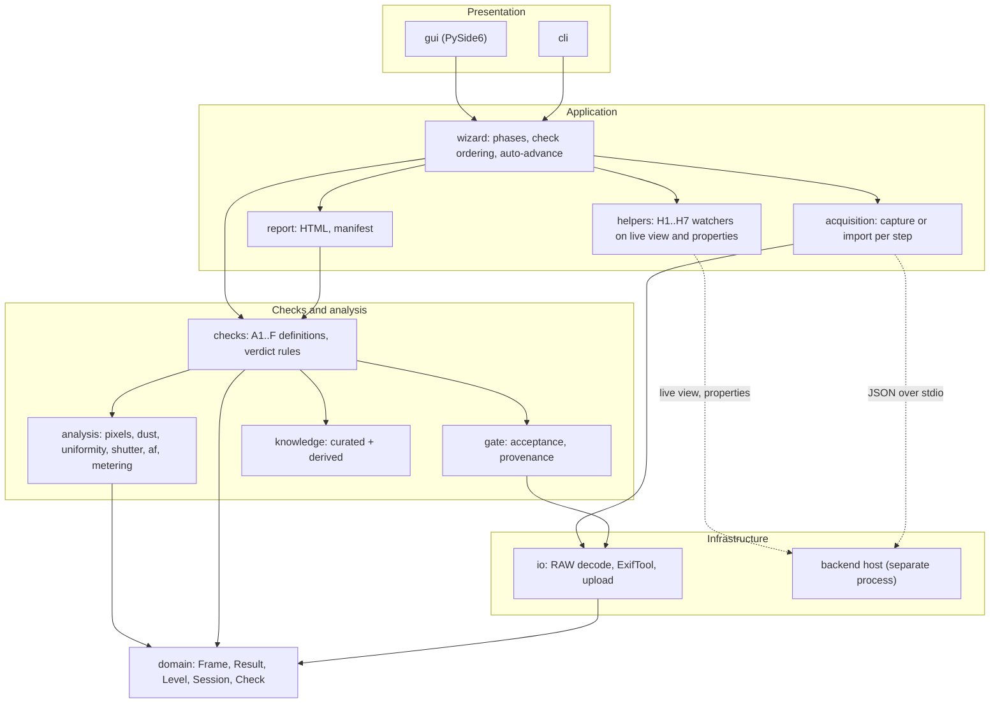
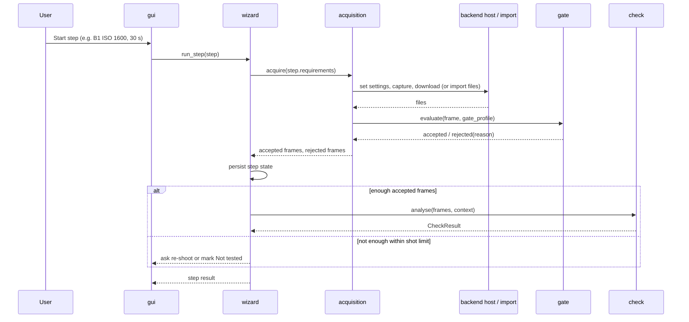

# Architecture and Technical Solution

Status: draft, revised 2026-10-17 after D-39 to D-45. Decisions referenced as `D-xx` (confirmed) or `P-xx`/`R-xx` (proposed, not yet binding) are tracked in [DECISIONS.md](DECISIONS.md). Evidence labels keep the handoff meaning.

## 1. Drivers

Quality attributes in priority order, derived from the SRS:

1. **Correctness and honesty of results**: no false Pass, every threshold traceable (NFR-01, NFR-08).
2. **Works without a camera connection**: upload mode is the guaranteed path and ships first (D-23, D-26).
3. **Testability without hardware**: analysis verifiable with synthetic data (R-08).
4. **Replaceable connection layer**: backends can change per brand and OS without touching analysis (H§5).
5. **Legal safety**: no vendor SDK files in the repo, source archives or CI builds; the maintainer's local binary release may bundle them, other builds use SDKs supplied by the user or the test environment (D-31, D-47); LGPL libraries replaceable (H§10).
6. **Distributable to non-technical users**: prebuilt Windows folder build, offline, no admin rights (NFR-09).
7. **Automation first**: in connected mode the app performs every camera action possible over USB; helpers detect the user's physical actions (D-25, D-34).

## 2. Technology selection

Each choice lists the options considered and the reason. "Chosen" items that come from the handoff are confirmed decisions; the rest are proposals.

### 2.1 Language and GUI toolkit

| Option | Strength | Weakness | Result |
| --- | --- | --- | --- |
| Python 3.12+ with PySide6 | Best analysis ecosystem; LGPL Qt binding `[Sourced]` | Larger build; USB from Python on Windows less proven | **Chosen** (D-09) |
| C# with Avalonia | FC.SDK and EDSDK wrappers in C# `[Sourced]` | Weaker analysis ecosystem | Kept as helper-process option for USB only |
| Rust with Tauri or egui | Small binaries | Costlier analysis and FFI | Not chosen |

Within PySide6:

| Option | Strength | Weakness | Result |
| --- | --- | --- | --- |
| Qt Widgets | Mature desktop controls, forms, tables; straightforward testing with pytest-qt; no QML runtime to package | Less fluid visuals | **Proposed (P-01)** |
| Qt Quick (QML) | Modern visuals and animation | Two languages, larger package, harder to test | Not chosen |

### 2.2 Core libraries

| Concern | Options | Proposed | Reason |
| --- | --- | --- | --- |
| RAW decoding | rawpy (LibRaw); direct LibRaw via ctypes; Adobe DNG SDK | **rawpy** | `[Sourced]` MIT wrapper over LibRaw (LGPL-2.1); exposes the raw CFA, black and white levels, CFA pattern. Format coverage per model is V-14 |
| Metadata and maker notes | ExifTool (subprocess); exiv2 bindings; rawpy only; in-house reader | **ExifTool, bundled** (D-42), behind a `MetadataReader` interface, run through a thin wrapper using `-stay_open` batch mode | Broadest maker-note decoding including AF info `[Sourced]`; exiv2 is GPL `[Unverified]` and would affect distribution; rawpy exposes too little. If V-16 rules out bundling, an in-house reader implements the same interface for the allowlisted fields (D-42) |
| Numerics and image analysis | NumPy + SciPy; OpenCV; scikit-image | **NumPy + SciPy** (R-13) | `scipy.ndimage` covers filtering, labelling and region statistics `[Inference]`; OpenCV only if D6 chart registration needs it |
| Evidence images | Pillow; matplotlib | **Pillow** for maps; hand-built SVG for charts | Small, prints well, no plotting runtime |
| Data models and schemas | pydantic v2; dataclasses + jsonschema | **pydantic v2** | Validation and JSON Schema export for report, session and KB |
| YAML | PyYAML; ruamel.yaml | **PyYAML** with `safe_load` only | Simple; NFR-16 |
| HTML report | Jinja2; string templates | **Jinja2** | Autoescaping; single self-contained output |
| Internationalisation | gettext + Babel; Qt Linguist | **gettext + Babel** for all app strings; Qt's own translations loaded for standard dialogs `[Unverified]` that Qt ships Vietnamese for them | One catalogue for GUI, core messages and report |
| Audio (later) | sounddevice (PortAudio) | sounddevice | N-05 only |
| Physical-action animations | Layered SVG + keyframe timeline (QGraphicsView, QPropertyAnimation); Lottie (needs Qt Quick); pre-rendered video or GIF | **Layered SVG + timeline** (D-19) | Text-free, themeable, small, diffable in git; one asset set serves the app and the mockup. Assets in `src/camera_preflight/gui/animations/` (one SVG with named layers plus one timeline file per action) |

Licence status of each dependency is tracked in [LICENSING.md](LICENSING.md); all are `[Unverified]` until V-11.

### 2.3 Device connection

The connection choice depends on spikes (V-10, V-13). Candidates, in evaluation order (R-03):

| Candidate | Windows driver change | Vendor operations | Effort | Status |
| --- | --- | --- | --- | --- |
| WPD (Windows Portable Devices) via `comtypes` or .NET | None | `[Unverified]` pass-through of vendor PTP operations (V-13) | Medium | Spike first |
| libusb (pyusb) + in-house PTP layer | Usually WinUSB via Zadig `[Inference]` | Full control | Medium | Spike second |
| .NET helper around FC.SDK (Canon) | WinUSB `[Sourced]` | Canon only, tested on 6D `[Sourced]` | Medium | Fallback |
| libgphoto2 | Awkward on Windows `[Sourced]` | Broad | High on Windows | macOS and Linux later |

**Proposal P-02: all device backends run out of process.** A backend host process talks to the app with JSON messages over stdin and stdout. Reasons:

- A crash in a native SDK or USB stack does not take down the GUI or lose the session `[Inference]`.
- The Python backends and a .NET helper use the same protocol, so the handoff fallback needs no app changes.
- Vendor SDK adapters (D-31), which load native SDK libraries supplied by the user, are isolated from the app process.

### 2.4 Build, packaging and tooling

| Concern | Proposed | Notes |
| --- | --- | --- |
| Environment and lock | uv with `uv.lock` | Reproducible CI and release builds |
| Lint and format | ruff | One tool |
| Type checking | pyright (strict on `domain`, `analysis`, `checks`) | PySide6 ships type stubs `[Unverified]` |
| Tests | pytest, pytest-qt, hypothesis, coverage | Property tests for analysis |
| Layer rules | import-linter | NFR-12 |
| Packaging | PyInstaller onedir, zipped; Nuitka standalone as fallback if antivirus false positives appear | H§13 `[Sourced]` onefile flagged more often |
| Installer | None for v0.1 (portable zip); Inno Setup optional later | NFR-09 |
| Code signing | None (D-41) | SmartScreen prompt on unsigned builds `[Sourced]`; steps documented in README and release notes |
| Target OS | Windows 10 22H2 and Windows 11, x64 (D-43) | CI tests on a Windows runner; no 32-bit or ARM builds |
| CI | GitHub Actions: lint, type, test on Windows and Linux; release workflow on tag builds the Windows zip with `SHA256SUMS` | Build from M0 (H§13) |

## 3. Logical architecture



Handoff layers map as: Camera and Connection backends = `backend host`; Acquisition = `acquisition`; Data = `io` + `knowledge`; Analysis = `analysis` + `gate`; Verdict = `checks` (verdict rules) + `report`.

### 3.1 One wizard step



## 4. Key abstractions

Illustrative signatures; final names may differ.

```python
class Level(StrEnum): PASS, SUSPECT, FAIL, NOT_TESTED
class Confidence(StrEnum): HIGH, MEDIUM, LOW
class Severity(StrEnum): BLOCKER, HIGH, MEDIUM, LOW
class ExecPath(StrEnum): TETHERED, SEMI_AUTOMATIC, FILE_IMPORT, MANUAL
class AutomationLevel(StrEnum): AUTOMATIC, HELPER, BUTTON, UPLOAD, MANUAL

@dataclass(frozen=True)
class Frame:
    id: str
    sha256: str
    source: Path
    cfa: CfaData               # lazily decoded: array, pattern, black/white levels
    meta: FrameMeta            # normalised fields + reference to full dump
    provenance: Provenance     # serial, capture time, file number, edit flags
    kind: FrameKind            # dark, flat, chart, burst, other

class Check(Protocol):
    id: str                    # "B1"
    group: str                 # "B"
    paths: frozenset[ExecPath]
    requirements: tuple[FrameRequirement, ...]   # settings, counts, gate profile
    max_shots: int             # design limit only; never shown to the user (D-32)
    automation: AutomationLevel  # per mode: automatic, helper, button, upload, manual (D-34)
    needs_sdk: frozenset[str]  # SDK capabilities; Not tested if absent (D-24)
    kb_fields: tuple[str, ...]
    def analyse(self, frames: FrameSet, ctx: CheckContext) -> CheckResult: ...

@dataclass(frozen=True)
class CheckResult:
    check_id: str
    level: Level
    confidence: Confidence | None
    severity: Severity | None
    path: ExecPath
    findings: tuple[Finding, ...]      # e.g. pixel coordinates, blobs, AF points
    evidence: tuple[EvidenceRef, ...]
    parameters: ParameterSetRef        # thresholds used, with evidence labels
    explanation: Message               # translatable code + params
    not_tested_reason: str | None

class CameraBackend(Protocol):          # implemented inside the backend host
    def capabilities(self) -> Capabilities: ...
    def device_info(self) -> DeviceInfo: ...
    def get_property(self, name: str) -> PropertyValue: ...
    def set_property(self, name: str, value: PropertyValue) -> None: ...
    def capture(self, timeout_s: float) -> CaptureOutcome: ...   # includes focus failure / timeout (R-01)
    def list_new_objects(self) -> list[ObjectRef]: ...
    def download(self, ref: ObjectRef, dest: Path) -> Path: ...
    def close(self) -> None: ...
```

Rules:

- `analysis` functions are pure: NumPy arrays and parameters in, findings out. No file, GUI or backend access.
- `checks` combine requirements, gate profile, analysis calls and verdict rules. Verdict rules are data-driven parameter sets with evidence labels, versioned with the app.
- Messages are codes plus parameters; text is resolved at render time in the user's language.

## 5. Data

### 5.1 Session result data (internal, outline)

Kept in the session folder for re-analysis; the user deliverable is the HTML report (D-27).

```json
{
  "schema_version": "1.0.0",
  "app": {"version": "0.1.0", "kb_version": "2026.1", "parameter_set": "default-1"},
  "session": {"id": "...", "started": "...", "mode": "connected | upload", "backend": "sdk:canon | ptp:sony | none"},
  "camera": {"brand": "...", "model": "...", "serial": {"read": "...", "entered": "...", "match": true},
             "firmware": "...", "shutter_count": {"before": 0, "after": 0, "source": "exif", "plausibility": []},
             "lens": "..."},
  "summary": {"pass": 0, "suspect": 0, "fail": 0, "not_tested": 0, "blockers": []},
  "results": [{"check_id": "B1", "level": "suspect", "confidence": "high", "severity": "medium",
               "path": "file_import", "findings": [], "evidence": [], "parameters": "...",
               "explanation": {"code": "...", "params": {}}}],
  "not_tested": [{"check_id": "C5", "reason": "requires_reference_instrument"}],
  "provenance": {"frames_total": 0, "frames_rejected": 0, "issues": []},
  "manifest": {"algorithm": "sha256", "hash": "...", "entries": [{"path": "...", "sha256": "..."}]}
}
```

### 5.2 Knowledge base (two tiers, R-07)

Curated entry (YAML in `knowledge-base/<brand>/<model>.yaml`):

```yaml
schema_version: 1
model: <brand and model name>
aliases: [<names as written in metadata>]
release_year: <year>            # source required
shutter:
  type: <mechanical | electronic | both | efcs>
  rated_life: {value: <count>, source: <url>, confidence: <high|medium|low>}
  max_burst_fps: {value: <fps>, source: <url>}
af:
  point_count: <number>
  layout_ref: <file with normalised coordinates and point types>
  metadata_decoder: <verified | unverified>
firmware:
  latest: {version: <x.y.z>, date: <yyyy-mm-dd>, source: <url>}
backend_hints:
  no_sdk: <canon_ptp | nikon_ext | sony_remote | libgphoto2 | none>
  usb_mode_note: <text>
known_issues:
  - id: <brand-model-nnn>
    description: <symptom>
    scope: <firmware or serial range>
    confirming_test: <test id>
    confidence: <high | medium | low>
    source: <url>
```

Derived record (per session, never committed): model and aliases as read, AF point count and selected-point coordinates where metadata exposes them, firmware, lens, sensor dimensions, available shutter modes.

Resolution: curated value if present, else derived value with confidence lowered, else "no reference data" (FR-KB-04).

## 6. Project structure

```
camera-preflight/
  README.md  LICENSE  NOTICE  CHANGELOG.md  CONTRIBUTING.md
  pyproject.toml  uv.lock
  .github/workflows/        ci.yml, release.yml
  docs/                     SRS, architecture, UX, roadmap, decisions, test catalogue
  knowledge-base/
    schema/                 generated JSON Schema
    canon/ nikon/ sony/     curated YAML per model; every model in scope (D-40)
    layouts/                AF point layouts
  packaging/
    pyinstaller/            onedir spec
    exiftool/               pinned ExifTool version and checksum; fetched at build time, not committed (D-42)
    licenses/               third-party licence texts collected at build
  src/camera_preflight/
    domain/                 Frame, Result, Level, Session, Check, Message (pure)
    analysis/               common/, pixels/, dust/, uniformity/, shutter/, af/, metering/
    checks/                 one module per group: group_a.py ... group_f.py, verdict parameter sets
    gate/                   acceptance rules, provenance
    io/                     raw.py (rawpy), metadata.py (MetadataReader interface, allowlist), exiftool.py (bundled ExifTool), upload.py
    knowledge/              schema, loader, derived builder, resolver
    helpers/                H1..H7 detectors (dark sensor, flat field, chart, steady, lens change, focus mode, card)
    acquisition/            step execution for tethered and import paths
    backends/               protocol, host process, ptp/, wpd/, sdk/ (canon, nikon, sony adapters; native SDK supplied at runtime)
    report/                 html renderer, templates/, manifest
    guide/                  AF chart, solid-colour test images, shooting parameters per step
    synth/                  synthetic frame generator with defect injection
    wizard/                 phases, ordering by automation level, auto-advance, fallback to manual
    cli/                    command-line entry points
    gui/                    app, views/, widgets/, viewmodels/, animations/ (SVG + timelines), reference/ (photos + ATTRIBUTION.md)
    locale/                 gettext catalogues (en, vi)
  tests/
    unit/  integration/  gui/
    fixtures/               small generated data
  tools/                    kb validation, string extraction, release helpers
```

Dependency rules (enforced by import-linter):

| Package | May import |
| --- | --- |
| `domain` | stdlib, pydantic, numpy |
| `analysis` | `domain`, numpy, scipy |
| `gate`, `knowledge`, `io` | `domain`, `analysis` (gate only) |
| `checks` | `domain`, `analysis`, `gate`, `knowledge` |
| `report`, `guide`, `synth` | the above |
| `helpers` | `domain`, `analysis`, `backends` (host client only) |
| `acquisition` | the above, `io`, `backends` (protocol and host client only) |
| `wizard` | everything except `gui` and `cli` |
| `cli`, `gui` | `wizard` and below; only `gui` imports PySide6 |
| `backends.*` implementations | `domain` only; loaded inside the backend host process |

## 7. Cross-cutting concerns

| Concern | Approach |
| --- | --- |
| Concurrency | Analysis runs in worker threads (GUI) or a process pool (CLI); wizard defines a task runner interface so GUI and CLI provide their own |
| Persistence | Atomic writes of session data after every check; no resume (D-36) |
| Logging | stdlib `logging`; per-session log file inside the session; no personal data |
| Errors | Typed errors from `io` and backends; wizard converts them into fallbacks or Not tested reasons (FR-ACQ-09, FR-CON-08) |
| Privacy | No network code in the app; only files the user selects per step are imported (FR-ACQ-02); metadata stored through an allowlist (FR-META-02) |
| SDK adapters | Adapter code lives in `backends/sdk/`; the native SDK is found in the default folder or the folder set by the user (FR-CON-06); adapters load only in the backend host. The test environment provides SDKs for adapter tests (D-31, V-23) |
| Versioning | SemVer for app, report schema and KB schema; KB data versioned by date (`2026.1`) |

## 8. Testing strategy

| Level | What | How |
| --- | --- | --- |
| Unit | analysis functions, gate rules, verdict rules, wizard ordering, schemas | pytest + hypothesis on synthetic arrays |
| Synthetic defect suite | B1 to B6, C2, C3, D3 | `synth` generates CFA frames with shot and read noise, vignetting, and injected defects (hot pixels, clusters, dead pixels, dust blobs scaled by aperture, linear scratches, banding, curtain gradients, flicker stripes, blur per AF region) plus ground-truth JSON; detection rate and false positives measured (NFR-02) |
| Integration | import, classify, decode, report on real RAW samples | Sample RAW files downloaded to a CI cache, not committed; source and licence per file recorded (V-19) |
| Golden reports | report JSON and HTML stability | Snapshot tests on synthetic sessions |
| GUI | wizard flows | pytest-qt on the demo session |
| Hardware | tethered paths | Manual protocol per release on available bodies; results logged in `docs/hardware-log/` |
| Packaging | build runs | CI starts the built app in a smoke-test mode (`--self-test`) that analyses the bundled demo session |

## 9. Security and privacy summary

- No network access by default; no telemetry.
- YAML safe loading; no code execution from data files.
- SDK adapters run in a separate process and only when an SDK is present.
- The app never reads owner name, copyright, Wi-Fi or similar camera settings.
