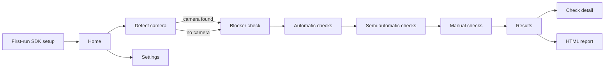

# UI/UX Design

Status: revised 2026-10-17 after maintainer decisions D-23 to D-45 ([DECISIONS.md](DECISIONS.md)). Requirements referenced as `FR-xx`/`NFR-xx` are in [SRS.md](SRS.md). The visual mockup is a separate, private Design artifact, frozen as a layout and flow reference (D-45); section 12 maps its frames to the screens below. Where the mockup and this document differ, this document prevails.

## 1. Design goals

1. **Diagnostics tool, not a questionnaire** (D-34): the app does everything it can by itself, in this order: automatic checks, then semi-automatic checks, then manual checks.
2. **Honest results**: level, confidence and execution path are always shown together. No Pass for a check that did not run.
3. **The PC does every camera action it can over USB** (D-25, D-34): settings, exposure parameters, shutter release, file download. The user only does what a cable cannot: fit a cap, aim the camera, swap a lens, look and judge.
4. **One action per screen** when the user has to act, with an animation (D-18) and, for visual checks, real reference photos (D-33).
5. **No estimates, no counters, no history** (D-32, D-36, D-37): the app shows no time estimate, no shot estimate, no list of past sessions, and does not resume interrupted sessions.

## 2. Modes and users

Two modes only (D-23):

| Mode | When | What the app does |
| --- | --- | --- |
| **Connected** | A camera is detected on USB | Controls the camera, shoots, downloads, analyses; falls back to guided manual steps when a command fails (D-25) |
| **Upload** | No camera detected, or the user chooses it | Every shooting step shows the exact parameters to use and an upload button; uploaded files are validated against the step's requirements and analysed (D-26, D-29, D-30) |

The mode is picked automatically: the app watches for a camera and its driver (FR-CON-01). The user can switch to upload mode at any time.

Users: an individual checking a used camera, at a seller's place or at home. Remote checks are possible in upload mode (the seller shoots with the shown parameters and sends the files), without a dedicated remote feature (D-30).

## 3. Wizard model

The wizard always contains every check that applies to the detected body (D-26, D-28). There are no profiles. Any check can be skipped by the user; it is then reported as Not tested, reason "skipped by user".

### 3.1 Phases

| Phase | Content | User involvement | Advance |
| --- | --- | --- | --- |
| 0 Start | First-run SDK setup (once), camera detection, optional printed serial | Minimal | Manual |
| 1 Blocker check (D-35) | About 30 seconds of yes/no questions on severe visible defects, with reference photos | Look and answer | Manual; a Blocker offers to stop |
| 2 Automatic | Checks the app can run alone | None | Runs, marks each result and advances by itself |
| 3 Semi-automatic | Checks that need the user to change something physical | One physical action per check group | **Detected**: a helper watches for the action and starts the check by itself. **Button**: where the action cannot be detected, the user presses "Done" |
| 4 Manual | Visual and tactile checks the app cannot measure | Look, listen, answer, with reference photos | Manual |
| 5 Results | Summary, details, HTML report | Read, save | Manual |

### 3.2 Behaviour of automatic checks

- A list of checks with live status: waiting, running, Pass, Suspect, Fail, Not tested.
- Each check runs, gets its result, and the next starts without user input.
- When a command fails (for example a setting cannot be written over USB), the app tries once more, then turns that single item into a guided manual step (animation and instruction), and continues automatically after the user confirms.
- The user can pause the run or skip a check at any time.

### 3.3 Helpers for semi-automatic checks

A helper watches live view, camera properties or test frames and starts the check when the condition is met. If the condition is not met within a time limit, the screen offers the button fallback.

| Helper | Detects | Signal | Used by |
| --- | --- | --- | --- |
| H1 Dark sensor | Body cap fitted, viewfinder covered | Live view or test frame mean near black level | B1 |
| H2 Flat field | Camera aimed at an even bright surface, image defocused | Live view low spatial variance, histogram in range | B2, B4, B5, C2, C3, C4, E1, E2, E4 to E7 |
| H3 Chart in view | AF chart visible, square to the camera | Chart pattern found in live view | D, E3 |
| H4 Steady camera | Camera on a tripod | Live view frame-to-frame motion below a limit | D, E3 |
| H5 Lens changed | A different lens is mounted | Lens ID or name property changes | D10, E7 |
| H6 Focus mode | AF/MF switch position | Focus mode property, where readable `[Unverified]` | B2, D |
| H7 Card present | Card inserted in a slot | Storage info changes | A5 |

`[Unverified]` Live view and property access differ per brand and backend (V-04, V-13); a helper that cannot run on a body falls back to the button.

Grouping: all checks that share a set-up run in one go after the helper fires. Example: once H2 detects a flat field, the app runs B2, B4, C2, C3, C4, E1, E2, E5, E6 and E7 in sequence, changing settings itself between them.

### 3.4 Upload mode

- Every shooting step shows the parameters to use (mode, aperture, shutter speed, ISO, file type, noise reduction, focus) and an upload button (D-26, D-29).
- On upload, the app checks the files against the step's requirements and gives a clear reason for any rejection, for example "exposure 1/60 s is too short for this check; use 30 s" (D-30).
- Accepted frames are analysed immediately and the step is marked.
- Steps with no shooting (blocker check, manual checks) are identical in both modes.

## 4. Information architecture

Persistent shell: top bar (app, camera, mode, language, settings), left list of phases and checks with live status, main area, bottom bar (Back, Skip, Next or auto-advance notice). No shot counter, no time estimate.

## 5. Screens

| ID | Screen | Content |
| --- | --- | --- |
| S0 | First-run SDK setup | Per brand: what the SDK adds (for example remote AF point selection, focus confirmation, newer bodies), where to download it, default folder, "Choose folder", status. "Continue without SDK" lists which checks will be skipped (D-24) |
| S1 | Home | Start check; Settings. No history (D-32) |
| S2 | Detect camera | Live detection status: driver, USB mode hint, camera identified, backend chosen (SDK or standard protocol). Optional printed serial. Switch to upload mode |
| S3 | Blocker check | 3 to 4 yes/no questions, each with an animation and reference photos (D-35) |
| S4 | Automatic run | Check list with live status, current check detail, auto-advance; fallback item when a command fails |
| S5 | Semi-automatic: waiting for action | Animation of the action, live helper indicator ("Waiting: body cap not detected yet"), button fallback after a time limit |
| S6 | Semi-automatic: running | Group of checks running after the helper fired, with live status |
| S7 | Semi-automatic: button variant | Instruction, animation, "Done" button (for actions that cannot be detected) |
| S8 | Upload step | Required parameters, upload button, validation results with reasons |
| S9 | Manual check | Instruction, animation, 4 reference photos with credit, Pass/Suspect/Fail/Not tested, notes, photo attachment |
| S10 | Results | Counts per level, Blockers first, Suspect list with confidence and severity, Not tested with reasons |
| S11 | Check detail | Explanation, evidence (pixel map, dust map, AF map, charts), frames used, method and thresholds |
| S12 | Report | Save the HTML report (D-27); restore camera settings changed by the app |
| S13 | Settings | Language, theme, reduced motion, SDK folders (same content as S0), sessions folder |
| S14 | Connection lost | What happened, nothing lost in the running session, reconnect or switch to upload mode |

## 6. Animations (D-18 to D-21)

- Every step with a physical action shows a looping 2D animation (FR-GUI-06).
- Two generic body types, DSLR and mirrorless; no brand shapes or logos (D-20).
- The control involved is highlighted; its name comes from a translatable label, never from text in the drawing.
- Pause and replay; a static key frame when the OS requests reduced motion.
- Camera menu settings are text only (D-21). In connected mode the app sets them itself; text appears only in the fallback.

Catalogue: plug USB cable; power on; turn camera to read serial; tilt camera to inspect mount; remove and mount lens; fit body cap; cover viewfinder; switch AF/MF; turn focus ring; turn command dial; half-press shutter; press and hold shutter; move AF joystick; open card door and remove card; insert card into reader; set up tripod and chart; aim at a flat bright surface; look through viewfinder and turn diopter; check lens mount play; raise pop-up flash; show solid-colour images; press each button; move frame across spot meter; mirrorless body sample.

## 7. Reference photos (D-33, D-38)

- Manual and blocker checks show up to 4 real photos of the defect, beside the animation.
- Each photo shows its credit (author, licence, source) on hover or under the photo, and the full list is in the About screen.
- Sources: openly licensed only; candidates and status in [REFERENCE-IMAGES.md](REFERENCE-IMAGES.md). Missing photos are filled by the maintainer.

## 8. Interaction rules

| Rule | Detail |
| --- | --- |
| Result vocabulary | Pass, Suspect, Fail, Not tested; never "OK", "Bad", "Good to buy" |
| Automatic marking | Automatic and semi-automatic checks set their own result; AF and metering use Suspect with confidence, never Fail from one lens or one repetition (D-03) |
| Never colour alone | Each level has an icon and text (NFR-15) |
| Confidence | Text "High / Medium / Low confidence" |
| Path | Badge: Automatic, Semi-automatic, From uploaded files, Manual |
| Auto-advance | After an automatic result the next check starts; a short notice shows what just finished; the user can pause |
| Helper timeout | After a time limit without detection, the button fallback appears; the helper keeps watching |
| Blocker | After the blocker check, a Blocker offers "Stop and save report" or "Continue" |
| Skip | Any check can be skipped; it becomes Not tested, reason "skipped by user" |
| Restore settings | At the end of a connected session, offer to restore every camera setting the app changed |
| Errors | Say what happened, what it means for results, and the next action |

## 9. Content guidelines

On-screen text is short and complete in meaning (D-44, FR-GUI-09). The screen says what to do or what was found; why and how live in the check detail and the report's method section.

| Element | Rule | Example (English / Vietnamese) |
| --- | --- | --- |
| Screen title | One line, at most about 8 words; names the action or the result | Fit the body cap / Lắp nắp thân máy |
| Instruction | At most 2 short sentences, imperative; one action per sentence | Aim at a white wall. Keep the camera still. / Chĩa máy vào tường trắng. Giữ máy yên. |
| Button | Verb first, at most 3 words | Start / Bắt đầu; Upload photos / Tải ảnh lên |
| Status and result | Level plus at most one short reason | Suspect: 4 hot pixels near centre / Nghi vấn: 4 điểm nóng gần tâm |
| Rejection reason | The value found and the value needed, nothing else | Exposure 1/60 s; needs 30 s / Phơi sáng 1/60 giây; cần 30 giây |
| Shooting parameters | A key and value table, no prose | ISO: 1600 |
| Notes and footnotes | None on the main screen. Background, caveats and method go to the check detail (S11) or the report | |
| Tooltips | Only for terms the user may not know (CFA, hot pixel, EFCS); one sentence | |

Other rules:

- Plain, neutral wording. State what was measured, not what it means for the purchase.
- No advice to buy, not buy, or negotiate a price.
- Unverified thresholds are labelled in the method section and in the report, not on the wizard screens.
- Vietnamese text follows the same limits; it is not a word-for-word translation of the English and may be shorter.

### 9.1 Core vocabulary (English and Vietnamese)

| Key | English | Vietnamese |
| --- | --- | --- |
| level.pass | Pass | Đạt |
| level.suspect | Suspect | Nghi vấn |
| level.fail | Fail | Không đạt |
| level.not_tested | Not tested | Chưa kiểm tra |
| confidence | Confidence | Độ tin cậy |
| severity.blocker | Blocker | Nghiêm trọng, nên dừng |
| severity.high / medium / low | High / Medium / Low | Cao / Trung bình / Thấp |
| path.automatic | Automatic | Tự động |
| path.semi_automatic | Semi-automatic | Bán tự động |
| path.uploaded | From uploaded files | Từ ảnh tải lên |
| path.manual | Manual | Thủ công |
| mode.connected | Connected | Cắm máy |
| mode.upload | Upload | Tải ảnh lên |

## 10. Accessibility and localisation

- Keyboard: full wizard operable without a mouse; visible focus.
- Contrast: WCAG 2.1 AA target for text; icons accompany colour.
- Text scaling: layout holds at 150% system scaling `[Guess]`.
- Localisation (D-15): English and Vietnamese complete in every release; all strings via gettext; no text in images; reports in the chosen language with language-neutral IDs. Layouts allow for longer Vietnamese text `[Inference]`.

## 11. Usability validation

| When | Method | Participants | Tasks | Success measure |
| --- | --- | --- | --- | --- |
| Before the first release | Moderated test on the demo session | 5 people `[Guess]`, at least 2 non-technical | Upload mode end to end; explain one Suspect result | All complete unaided; at least 4 of 5 explain Suspect as "not proven" |
| Before connected mode ships | Session on a real body | 2 people | Connected mode end to end | No step where the user had to do something the app could have done over USB |

Findings go to `docs/ux-findings/`.

## 12. Mockup index (D-45)

The mockup is a private Design artifact owned by the maintainer (Vietnamese text only, rendering not checked on every frame). Agents that cannot open it work from this document. It is a reference for layout and flow, not for copy: its on-screen text is longer than section 9 allows.

| Row | Frames | Screen |
| --- | --- | --- |
| 1 | First-run SDK setup; Home; Detect camera (found); Detect camera (none) | S0, S1, S2 |
| 2 | Blocker check; Blocker found | S3 |
| 3 | Automatic run; Command failed, manual fallback | S4 |
| 4 | Dark: waiting (H1); Dark: running; Flat: waiting (H2); Flat: running the group; Chart: waiting (H3, H4); AF: running per point; Second lens: waiting (H5) | S5, S6 |
| 5 | AF point chosen by the user (button); AF/MF switch (button) | S7 |
| 6 | Manual checks 1 to 9: body, controls, screens and EVF, viewfinder, mount play, flash, ports and battery and video, lens, shutter sound | S9 |
| 7 | Upload: test photo (A1 to A5, C1, D9); dark frames with a rejected file; flat-field sets; AF chart | S8 |
| 8 | Results (with shutter count before and after); pixel detail; AF map detail; HTML report | S10, S11, S12 |
| 9 | Settings; Connection lost | S13, S14 |
| 10 | Shared parts: animation library (24 scenes), top bar, bottom bar, step list, animation panel, reference photo strip | All |

Known differences between the mockup and the documents:

- The mockup's notes and explanations break D-44; follow section 9.
- The report frame shows a SHA-256 code. That feature depends on N-10, which is Proposed.
- The shutter sound frame has the app fire 6 shots at different speeds while the user listens; the connection-lost frame offers an upload for the interrupted check; the results frame has a "path" column. They are consistent with D-25, D-29 and FR-TST-02.
