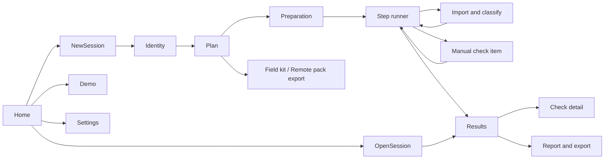

# UI/UX Design

Status: draft for maintainer review. Requirements referenced as `FR-xx`/`NFR-xx` are in [SRS.md](SRS.md). Wireframes are low fidelity; layout and wording will change after usability testing (section 10).

## 1. Design goals

1. **Honest first**: the user must never read a result as stronger than the evidence. Level, confidence and path are always visible together.
2. **One action per screen**: each wizard step asks the user to do one thing and tells them what they should see.
3. **Cost visible before it is spent**: shots, minutes and shutter actuations are shown before shooting and counted during it.
4. **Recoverable**: any step can be re-run; leaving the app never loses completed steps.
5. **Works under pressure**: the Quick flow must be completable on site in 20 to 30 minutes `[Guess]`, with or without a laptop present.

## 2. Personas and context of use

| Persona | Context | Goal | Constraints | Primary flow |
| --- | --- | --- | --- | --- |
| P1 On-site buyer (U1) | Meets a seller in a cafe or shop | Spot serious faults fast | Little time; maybe no laptop on site; social pressure | Field kit, then Quick by file import |
| P2 Remote buyer (U2) | Buys from an online listing | Get evidence before paying or travelling | Depends on seller's cooperation; cannot see the body | Remote pack, then import |
| P3 Home tester (U3) | Has the camera at home, return window open | Thorough check | Has time, tripod, second lens | Standard or Full, tethered |
| P4 Contributor (U4) | Enthusiast or developer | Add model data | Needs schema and validation | CLI and docs (no GUI flow) |

## 3. Key journeys

### J1 On-site Quick (P1)

1. At home: open app, New session, choose **On site**, pick the model if known, choose Quick, export the field kit (print or save to phone).
2. On site: follow the printed script on the camera (about 23 shots), tick the reduced F checklist.
3. Import the card (on site with a laptop, or later at home). The app classifies frames; user confirms.
4. Results screen: Blockers first, then Suspect items with confidence.
5. Export report; optionally show it to the seller.

### J2 Remote pre-check (P2)

1. New session, choose **Remote**, choose the model, the app proposes a reduced plan suitable for a seller (no tripod, no AF chart).
2. Export remote pack (printable page and short text for messaging).
3. Receive files; import. Provenance checks run first; failed frames are excluded with reasons.
4. Results are capped at Medium confidence and labelled "seller-supplied".

### J3 Home Standard or Full (P3)

1. Connect camera; the app identifies it and shows the required USB mode.
2. Plan: choose Standard, adjust budget, review actuations share.
3. Preparation checklist; each step runs tethered where possible, otherwise guided.
4. Results, detail views, report. Optional: save as baseline for a later compare.

### J4 Re-check (P3, later)

Open a past session, choose **Re-run and compare**; the same plan runs; the report shows differences.

## 4. Information architecture



Persistent shell: left sidebar with the step list (status icon per step), main area, bottom bar with Back, Next, and the shot counter.

## 5. Screen specifications

### S0 Home

```
+------------------------------------------------------------------+
| camera-preflight                                   [Settings]    |
|                                                                  |
|  [ New check ]      [ Open previous ]      [ Try demo ]          |
|                                                                  |
|  Recent sessions                                                 |
|  - 2026-10-12  <model>  ...4821   Quick     2 Suspect   [Open]   |
|  - 2026-10-03  <model>  ...0193   Standard  0 Suspect   [Open]   |
|                                                                  |
|  This app suggests what to check further. It does not tell you   |
|  whether to buy.                                                 |
+------------------------------------------------------------------+
```

### S1 New check: where are you?

Four cards, one choice:

| Card | Description shown | Leads to |
| --- | --- | --- |
| On site, short time | Shoot from a printed script, import later | Quick, file import, field kit offered |
| At home, camera connected | The app controls the camera over USB where possible | Detection, Standard default |
| Remote, seller sends files | Send a shooting script to the seller | Remote pack |
| I already have the files | Analyse a folder | Import directly |

### S2 Camera identity

```
+---------------------------+--------------------------------------+
| Steps                     | Camera                               |
| > Camera                  | Detected:  <brand> <model>  (USB)    |
|   Plan                    | Firmware:  1.2.0                     |
|   Preparation             | Serial (read):  ****4821             |
|   ...                     | Serial printed on body: [__________] |
|                           |   (optional; checks frames are from  |
|                           |    this body)                        |
|                           | USB mode: set "Remote Shooting"      |
|                           |   [How to]                           |
|                           | Knowledge base: curated entry found  |
+---------------------------+--------------------------------------+
| [Back]                                      Shots 0      [Next]  |
+------------------------------------------------------------------+
```

When no camera is connected, the model is selected from a searchable list or read from the first imported file.

### S3 Plan

```
+---------------------------+--------------------------------------+
| Steps                     | Plan   ( Quick ) ( Standard ) ( Full )|
|                           | Budget: shots [ 30 ]  minutes [ 25 ] |
|                           |                                      |
|                           | [x] A1 Identification     0 sh  1 min|
|                           | [x] A3 Shutter count      1 sh  1 min|
|                           | [x] F  Physical (short)   0 sh  5 min|
|                           | [x] B1 Dark frames        6 sh  4 min|
|                           | [x] B2 Flat frames        3 sh  3 min|
|                           | [x] B4 Dust               3 sh  2 min|
|                           | [x] C1 Burst              10 sh 1 min|
|                           | [ ] D5 AF (needs tripod) 15 sh 10 min|
|                           |                                      |
|                           | Total 23 shots, about 17 min         |
|                           | = 0.01% of rated shutter life        |
|                           | Dropped for budget: none             |
|                           | [Export field kit]                   |
+---------------------------+--------------------------------------+
```

Rules: deselected tests show "will be reported as Not tested (skipped by you)". Planner suggestions show why a test was dropped (FR-PLN-04).

### S4 Preparation

Checklist of equipment and camera settings for the selected plan (FR-GUI-04). Items can be ticked; unticked items do not block, but steps that need them warn at start.

### S5 Step runner

```
+---------------------------+--------------------------------------+
| Steps                     | B1 Dark frames  (2 of 6 configs)     |
| v Camera                  |                                      |
| v Plan                    | 1. Put the body cap on.              |
| v Preparation             | 2. Set ISO 1600, 1 second, RAW.      |
| > B1 Dark frames   2/6    | 3. Turn long-exposure NR off.        |
|   B2 Flat frames          |   [illustration]                     |
|   B4 Dust                 |                                      |
|   C1 Burst                | [ Capture 3 frames ]  or [ Import ]  |
|   F  Physical             |                                      |
|   Results                 | Frames                               |
|                           |  #1 accepted                         |
|                           |  #2 accepted                         |
|                           |  #3 rejected: NR is on (G1) [Retake] |
+---------------------------+--------------------------------------+
| [Back]   [Skip test]                  Shots 8 / 23      [Next]   |
+------------------------------------------------------------------+
```

Behaviour:

- Tethered: "Capture" applies settings and shoots; settings that cannot be set remotely are shown as instructions.
- File import: "Import" opens the import screen filtered to this step.
- Rejected frames show the gate rule in plain words and a Retake action; retakes count towards shots.
- Analysis runs in the background; the user can continue to the next step.

### S5b Import and classify

Pre-selection follows the session's import window (FR-ACQ-02). In an "I already have the files" session nothing is pre-selected; the screen opens on a list grouped by capture date where the user ticks dates or files.

```
+------------------------------------------------------------------+
| Import 31 files from E:\DCIM\100CANON                            |
| Not selected: 214 files taken before this session [Show / add]   |
|                                                                  |
| Dark (6)   [thumb][thumb][thumb][thumb][thumb][thumb] -> B1      |
| Flat (6)   [thumb][thumb][thumb] -> B2  [thumb][thumb][thumb]->B4|
| Burst (10) [thumb]...                                -> C1        |
| Other (9)  [thumb]...                                -> not used |
|                                                                  |
| Provenance: all frames from serial ****4821                [ok]  |
| [Change assignment]                         [Cancel] [Confirm]   |
+------------------------------------------------------------------+
```

### S6 Manual check item (group F)

One item per screen: instruction, optional reference image, four buttons (Pass, Suspect, Fail, Not tested), notes field, "Attach photo". Keyboard shortcuts 1 to 4.

### S7 Results overview

```
+------------------------------------------------------------------+
| <model>  ****4821   Quick   2026-10-16                           |
| Pass 6   Suspect 2   Fail 0   Not tested 3                       |
|                                                                  |
| Blockers: none                                                   |
|                                                                  |
| Suspect                                                          |
|  [!] B1 Hot pixels: 3 isolated, 1 cluster   High conf.  Medium   |
|  [!] C1 Burst: 1 stall at frame 7           Low conf.   Low      |
|                                                                  |
| Pass        A1, A3, B2, B4, F (7 items)                          |
| Not tested  D5 (skipped by you), C5 (needs instrument), A5 (USB) |
|                                                                  |
| [Report and export]                                              |
+------------------------------------------------------------------+
```

Each row opens S8. Wording for Suspect: "worth checking further; not proven".

### S8 Check detail

Tabs: **Finding** (plain explanation, level, confidence, severity, path), **Evidence** (zoomable pixel map, dust map, AF point map, charts), **Frames** (accepted and rejected with reasons), **Method** (parameters, thresholds with evidence label, e.g. "estimated threshold, not yet calibrated").

AF point map: points drawn on the frame outline, each with icon and colour by level; hovering shows per-attempt data.

### S9 Report and export

Options: Save HTML report; Save JSON; Export session as zip; Save as baseline; Field kit; Remote pack. Shows the manifest hash with a "What is this?" explanation: it links the report to the original files, so someone with those files can re-check the results; it does not prove the report was not edited. "Export session as zip" offers to leave out original frames (FR-SES-07).

### S10 Settings

Language; theme; sessions folder; ExifTool path (if not bundled); SDK adapters (path, status, licence reminder); advanced: parameter set (read only in v0.1).

## 5a. Physical-action animations (D-18 to D-21)

- Every step with a physical action shows a looping 2D animation above the instructions (FR-GUI-06).
- Two generic body types, DSLR and mirrorless, chosen from the detected or selected model; no brand shapes or logos (D-20).
- The control involved is highlighted; its name comes from a translatable label, never from text inside the drawing.
- Controls: pause, replay; static key frame when the OS requests reduced motion.
- Menu settings are text only (D-21).

Animation catalogue (reused across steps): plug USB cable; power on; remove and mount lens; fit body cap; cover viewfinder; switch AF/MF; turn focus ring; turn command dial; half-press shutter; press and hold shutter; move AF joystick; turn camera to read serial; tilt camera to inspect mount; open card door and remove card; insert card into reader; set up tripod and chart; aim at a flat bright surface; look through viewfinder and turn diopter; check lens mount play; raise pop-up flash.

## 6. Interaction rules

| Rule | Detail |
| --- | --- |
| Result vocabulary | Pass, Suspect, Fail, Not tested; never "OK", "Bad", "Good to buy" |
| Never colour alone | Each level has an icon and text: Pass (check), Suspect (triangle), Fail (cross), Not tested (dash) (NFR-15) |
| Confidence | Text "High / Medium / Low confidence" with a three-segment bar |
| Path | Badge: Automatic, Semi-automatic, From files, Manual |
| Shot counter | Always in the bottom bar: used / planned; turns amber above plan |
| Blocker | Modal after the phase that found it: "We recommend stopping here" with Stop and report / Continue |
| Skip | Any test can be skipped; it becomes Not tested with reason |
| Background work | Progress per step in the sidebar; cancel available; app never freezes (NFR-04) |
| Restore settings | At session end, offer to restore all camera settings changed by the app (FR-ACQ-06) |
| Errors | Say what happened, what it means for results, and the next action; never a raw stack trace |

## 7. Content guidelines

- Plain, neutral sentences. State what was measured and what it may mean.
- No advice to buy, not buy, or negotiate a price.
- Unverified thresholds are labelled in the Method tab and in the report.
- Remote results always carry "seller-supplied frames".
- Explain jargon on first use with a tooltip (CFA, hot pixel, EFCS).

### 7.1 Core vocabulary (English and Vietnamese)

| Key | English | Vietnamese (proposed) |
| --- | --- | --- |
| level.pass | Pass | Đạt |
| level.suspect | Suspect | Nghi vấn |
| level.fail | Fail | Không đạt |
| level.not_tested | Not tested | Chưa kiểm tra |
| confidence | Confidence | Độ tin cậy |
| severity.blocker | Blocker | Nghiêm trọng, nên dừng |
| severity.high / medium / low | High / Medium / Low | Cao / Trung bình / Thấp |
| path.automatic | Automatic | Tự động |
| path.semi_automatic | Semi-automatic | Bán tự động |
| path.file_import | From files | Từ tệp ảnh |
| path.manual | Manual | Thủ công |
| shots | Shots | Số lần chụp |

## 8. Accessibility and localisation

- Keyboard: full wizard operable without a mouse; visible focus.
- Contrast: WCAG 2.1 AA target for text; icons accompany colour.
- Text scaling: layout holds at 150% system scaling `[Guess]` target.
- Localisation (D-15): English and Vietnamese complete in every release; all strings via gettext; no text in images; dates and numbers formatted per locale; reports, field kit and remote pack in the chosen language with language-neutral IDs. Layouts must allow for Vietnamese text, which is often longer than English `[Inference]`.

## 9. Visual style (initial tokens)

| Token | Use | Note |
| --- | --- | --- |
| `level-pass` | Pass | Green family |
| `level-suspect` | Suspect | Amber family |
| `level-fail` | Fail | Red family |
| `level-not-tested` | Not tested | Neutral grey |
| `surface`, `surface-alt`, `text`, `text-muted`, `accent` | Shell | Light and dark variants follow OS theme |

Exact colour values are chosen and contrast-checked during M2 for both themes.

## 10. Usability validation

| When | Method | Participants | Tasks | Success measure |
| --- | --- | --- | --- | --- |
| M2, before v0.1 | Moderated test on the demo session | 5 people `[Guess]`, at least 2 non-technical | J1 from import to report; explain one Suspect result in their own words | All complete J1 unaided; at least 4 of 5 explain Suspect as "not proven" |
| M3, before v0.2 | Remote pack dry run | 2 buyer and seller pairs | J2 end to end | Seller completes the script without contacting the buyer |
| M4, before v0.3 | Tethered session on a real body | 2 people | J3 Standard | No lost steps; restore settings used |

Findings are logged in `docs/ux-findings/` and fed back into this document.
